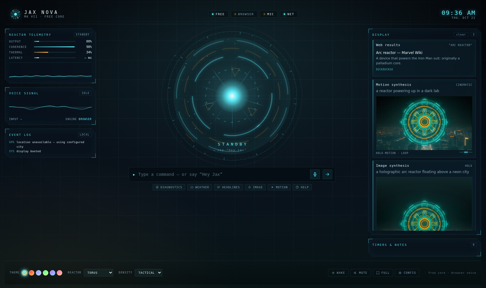
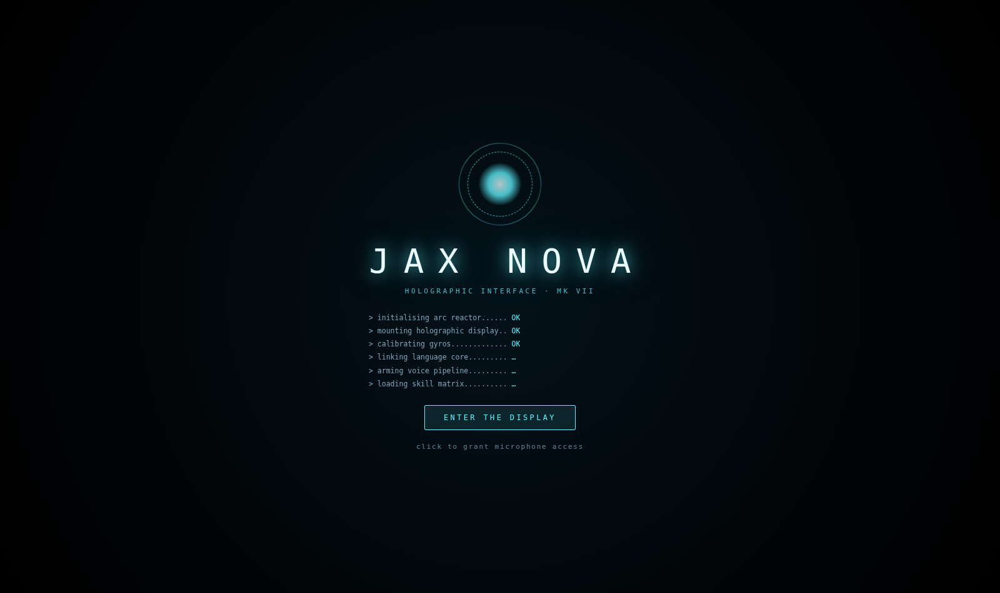
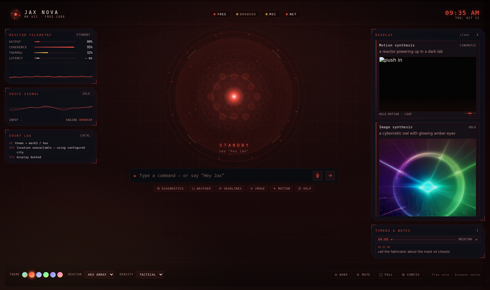
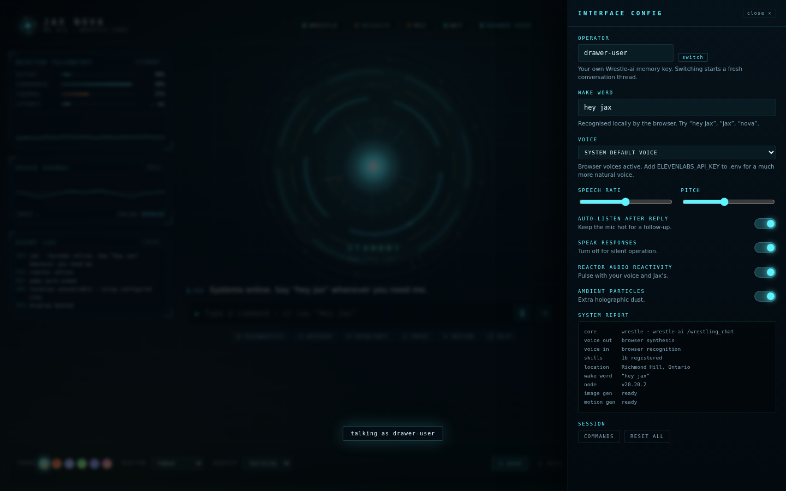
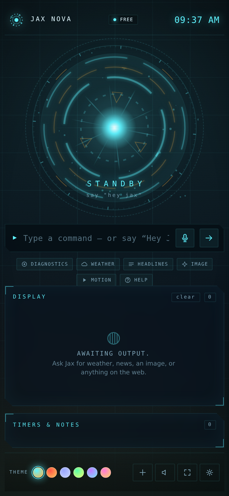
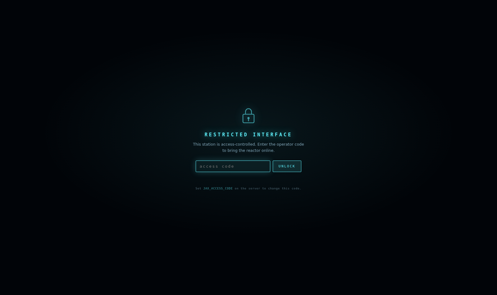
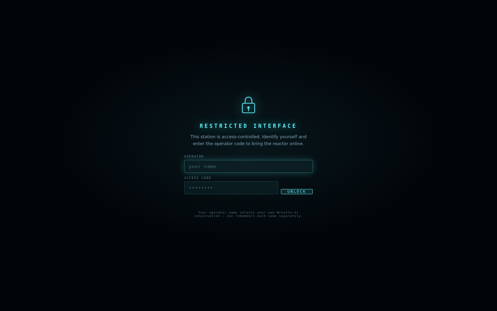
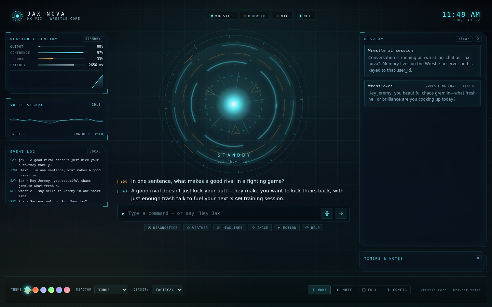

# ◉ JAX NOVA

**A holographic, Iron-Man-style voice assistant that runs on your machine — or on Railway in about a minute.**

[](https://github.com/YOUR-USERNAME/jax-nova/actions/workflows/ci.yml)
[](https://railway.com/new)
[](LICENSE)
[](package.json)
[](package.json)

Say **“Hey Jax”**, ask it something, and it answers out loud while the HUD lights up with weather, news, images, timers and search results.

No build step. No `npm install`. No API keys required — everything degrades to a working keyless path.

```bash
node server/server.js      # then open http://localhost:8787 in Chrome or Edge
```

> **First time pushing?** Replace `YOUR-USERNAME` in the CI badge and the
> `git remote` line below with your GitHub handle.
>
> **Deploying?** Railway terminates TLS for you, which means the wake word works
> for everyone who visits — browsers only allow microphones on `https://` or
> localhost. See **[DEPLOYMENT.md](DEPLOYMENT.md)**. Set `JAX_ACCESS_CODE` before
> you share the URL.



<sub>Arc reactor · live weather, news and generated imagery on the display panel · **Mark III** and **Mobile** views in `docs/`</sub>

---

## Deploy to Railway

1. Push this repo to GitHub.
2. [railway.com/new](https://railway.com/new) → **Deploy from GitHub repo** → pick it. Railway finds the `Dockerfile` and builds it.
3. Add `JAX_ACCESS_CODE` (plus any API keys) under **Variables**.
4. **Settings → Networking → Generate Domain**, open the `https://` URL, allow the mic.

That's it. Optional next steps: set the healthcheck path to `/api/health`, and attach a volume at **`/data`** so generated images survive redeploys.

<details>
<summary>What's in the repo for deployment</summary>

| File | Purpose |
| --- | --- |
| `Dockerfile` | `node:22-alpine`, `HEALTHCHECK`, `JAX_DATA_DIR=/data`. Railway always prefers a Dockerfile. |
| `docker-entrypoint.sh` | Takes ownership of a mounted volume, then drops to the unprivileged `node` user. |
| `Procfile` | Fallback start command for Procfile-based builders. |
| `package.json` | `start` script + `engines.node>=20` — the Railpack contract. |
| `.github/workflows/ci.yml` | Runs the tests on Node 20/22, builds the image, boots it, and asserts the auth gate behaves. |
| `DEPLOYMENT.md` | Railway / Docker / VPS guide, env matrix, troubleshooting. |

There is deliberately **no `railway.json`**: Config as Code is deprecated with a
hard cutoff on 2026-12-01 and new services cannot opt in, so build and start
settings live in the Dockerfile and the platform reads `$PORT` directly.

</details>

---

## Why it feels fast

Most voice assistants wait for a cloud round-trip before doing anything. Jax Nova is built the other way round:

| Layer | What it handles | Typical latency |
| --- | --- | --- |
| **Local router** (`server/router.js`) | time, date, timers, themes, mute, sleep, notes, greetings | ~0 ms |
| **Intent layer** (`server/intents.js`) | weather, news, open a site, draw/create an image, video, search, “who is…”, calculations | 100 ms – 2 s |
| **Brain** (`server/brain.js`) | anything conversational or multi-step | 2 – 8 s |

The first two are deterministic code paths — no model in the loop — which is why “what’s the weather” feels instant, and why the assistant still works when the language model is rate-limited or offline.

---

## Quick start

**Requirements:** Node.js 18.17+ (20+ recommended) and Chrome or Edge for the voice features.

```bash
cd jax-nova
node server/server.js
```

Open **http://localhost:8787**, click **ENTER THE DISPLAY**, allow the microphone, then say:

> “Hey Jax, what’s the weather?”

Optionally copy `.env.example` to `.env` and fill in whichever keys you have — everything is optional and hot-detected at boot:

```bash
cp .env.example .env
```

Or use the launcher, which checks your Node version and creates `.env` for you:

```bash
./start.sh
```

> **Microphone note:** browsers only allow mic access on `localhost` or an `https://` origin. Over a LAN IP (e.g. `http://192.168.1.5:8787`) the interface still works, but voice input is disabled and you type instead.

---

## Optional keys (each one upgrades a specific layer)

| Variable | Effect | Without it |
| --- | --- | --- |
| `JAX_LOCAL_VOICE_URL` | **Free local voice** — cloned-voice TTS + Whisper transcription from Voicebox/VoiceStudio on your machine | Next voice provider down the ladder |
| `ELEVENLABS_API_KEY` | Natural neural voice + **Scribe** transcription | Browser `speechSynthesis` + `SpeechRecognition` |
| `ANTHROPIC_API_KEY` | Claude with native **tool use** — the best brain | Keyless fallback brain |
| `JAX_USE_CLAUDE_CLI=true` | Use your local `claude` CLI login instead of an API key | — |
| `OPENAI_API_KEY` | OpenAI-compatible endpoint (any base URL) + image generation | — |
| `JAX_BRAIN=wrestle` | Conversational replies from a **Wrestle-ai** `/wrestling_chat` deployment ([see below](#wrestle-ai-bridge)) | Local/keyless brain |

Everything degrades in a defined order:

```
Brain   →  Claude (tools)  →  OpenAI  →  keyless text model  →  pattern-matched skills
Voice   →  Local (Voicebox/VoiceStudio)  →  ElevenLabs TTS  →  browser speechSynthesis
Transcription → Local Whisper → ElevenLabs Scribe → browser SpeechRecognition
Search  →  DuckDuckGo (via reader proxy) → Bing RSS → Wikipedia
Images  →  FLUX.1-schnell (HF Space) → FLUX.1-dev → Pollinations → local SVG schematic
```

Nothing ever leaves you with a dead screen: if every image provider is rate-limited, Jax renders a procedural holographic schematic and says so.

---

## Clone a voice from an audio file

Jax can speak in a voice cloned from a recording — either **free and local**
or via the ElevenLabs cloud. Either way it happens in **CONFIG → Clone a
voice from audio**: name the voice, choose the file, tick the consent box
(only clone your own voice, or one you have the speaker's permission to
clone), and hit **CLONE VOICE**. With *Make it Jax's main voice* ticked, Jax
switches immediately and introduces itself in the new voice. To keep it
across restarts, pin it in the environment — the CONFIG panel prints the
exact line (`JAX_LOCAL_VOICE_ID=…` or `ELEVENLABS_VOICE_ID=…`) after cloning.

### Free — on your own machine (Voicebox / VoiceStudio)

Two open-source desktop apps do the cloning locally, and both expose the
same OpenAI-compatible speech API (`POST /v1/audio/speech`), so Jax drives
either one with a single integration — cloned-voice TTS **and** Whisper
transcription for push-to-talk, no key, no credits, fully offline:

| App | Licence | Point Jax at | Engines inside |
| --- | --- | --- | --- |
| [Voicebox](https://github.com/jamiepine/voicebox) ([voicebox.sh](https://voicebox.sh)) | MIT | `JAX_LOCAL_VOICE_URL=http://127.0.0.1:17493` | Qwen3-TTS, LuxTTS, Chatterbox, TADA, Kokoro presets… |
| [VoiceStudio](https://github.com/debpalash/VoiceStudio) ([voicestudio.sh](https://voicestudio.sh)) | AGPL-3.0 | `JAX_LOCAL_VOICE_URL=http://127.0.0.1:3900` | OmniVoice (default), VoxCPM2, CosyVoice… 646 languages |

1. Install either app and let it download a TTS model (Voicebox → Models).
   Keep the app running — its local API only listens while it's open.
2. Add the `JAX_LOCAL_VOICE_URL` line above to `.env` and restart Jax. The
   port auto-detects which app it is; any other OpenAI-compatible speech
   server (Speaches, LocalAI…) also works for TTS/STT.
3. Clone in CONFIG, or clone in the app itself — existing profiles appear in
   the voice list badged `· clone` / `· preset`. Local zero-shot engines
   clone from a **clean clip of a few seconds plus its transcript**; type
   the transcript into the clone form for the best match (for Voicebox, Jax
   Whisper-transcribes the sample for you if you leave it blank).

The catches, honestly: it runs on **your** hardware (models are gigabytes;
a GPU or Apple Silicon is comfortable, CPU works with the small/fast engines
but can be slower than real time — expect the first reply to take a while
while the model loads), and the **Jax server must be able to reach the app**
— so run Jax on the same machine (or LAN/Tailscale host) as Voicebox or
VoiceStudio. A Jax deployed on Railway can't see your laptop's `127.0.0.1` —
but you can deploy the voice app as a **second service in the same Railway
project** and let Jax reach it over the private network instead
(`http://voicebox.railway.internal:17493`); the full walkthrough, including
the CPU/cost reality check, is in
[DEPLOYMENT.md](DEPLOYMENT.md#free-voice-on-railway-voiceboxvoicestudio-as-a-second-service).
At home the sample never leaves your machine, which is the point. App licence
≠ model licence: each engine's weights carry their own terms (some
non-commercial), so check before commercial use.

### Cloud — ElevenLabs

Set `ELEVENLABS_API_KEY` (`.env` locally, or your host's variables) and Jax
uses [Instant Voice Cloning](https://elevenlabs.io/docs/eleven-creative/voices/voice-cloning/instant-voice-cloning)
instead (best when Jax itself is hosted, e.g. on Railway). Cloning needs a
plan that includes Instant Voice Cloning (Starter or above); prepare **1–2
minutes of clean, single-speaker audio** — no music, reverb or background
noise; MP3 at 192 kbps+ is ideal. Voices you cloned in the ElevenLabs app
also appear in the CONFIG list as soon as the key is set. Samples are
forwarded to ElevenLabs and never written to disk here, and ElevenLabs may
hold a new clone for **voice verification** — finish that under Voices at
elevenlabs.io, then select the voice in CONFIG.

Provider order is local → ElevenLabs → browser; force one with
`JAX_VOICE_PROVIDER=local|elevenlabs|browser`. The clone endpoint sits behind
the access-code gate and is heavily rate-limited because each clone spends a
profile/voice slot with the provider. Set `JAX_VOICE_CLONE=false` on a
deployment where other people hold the access code.

---

## Wrestle-ai bridge

Jax can hand its conversation to [CyberFights/Wrestle-ai](https://github.com/CyberFights/Wrestle-ai),
a separate Express + Mistral service that exposes `POST /wrestling_chat`. It is a
one-route bridge: Jax sends the message, the endpoint answers with `{ response }`.

```bash
JAX_BRAIN=wrestle
WRESTLE_AI_URL=https://wrestle-ai-production.up.railway.app
WRESTLE_USER_ID=jax-nova          # memory key — pick something unguessable in public
WRESTLE_SEND_PERSONA=true         # send the built-in Jax Nova persona as system_p
WRESTLE_TIMEOUT_MS=45000
```

**The persona ships in the repo** (`server/personas.js`) and is sent as
`system_p` on every turn: first person, no asterisks or stage directions, no
admitting to being an AI, 250-token casual replies, creator credit preserved.
`stripStageDirections()` enforces the no-roleplay rule on the way *out* too, so a
model that slips into `*smiles*` never gets read aloud as "asterisk smiles
asterisk".

**Memory stays on the Wrestle-ai server.** `/wrestling_chat` replays its own last
10 turns for a `user_id` (stored in its MongoDB), so Jax deliberately sends only
the new message. Forwarding the local transcript would double every turn in the
prompt and burn the token cap. That also means the conversation survives a page
reload — Jax picks up where you left off even after a redeploy.

**Local skills still win.** Weather, timers, notes, maths, searches, image themes
and the reactor controls are answered by the local router and never reach the
bridge, so they stay instant and free. Only open-ended conversation is
outsourced.

**It fails open.** If the endpoint is down, slow or returns an error, Jax falls
through to the keyless brain instead of going mute:

```bash
$ JAX_BRAIN=wrestle WRESTLE_AI_URL=http://127.0.0.1:9  # dead host
→ provider: free   ·   reply: "Octopuses have three hearts and blue blood…"
```

Two ways to use it:

- **As the brain** — `JAX_BRAIN=wrestle`, described above.
- **As a side channel** — leave the brain alone and use the `/wrestle <message>`
  command in the HUD, `POST /api/wrestle/chat`, or the `wrestle_chat` skill
  (available to Claude and the keyless brain as a tool). Handy for comparing the
  two voices side by side.

### Who is talking? (operator names)

The lock screen has an **operator** bar above the access code. Whatever you type
there becomes your `user_id` on `/wrestling_chat`, so everyone sharing one
deployment gets their own conversation instead of talking over each other:

```
operator  jeremy        →  user_id "jeremy"
access code  ••••••••   →  same code for everyone
```

Names are slugified (`Jeremy Smith` → `jeremy-smith`) and limited to 2–48
characters of letters, numbers, dot, dash and underscore. Leave it blank and you
get `WRESTLE_USER_ID` — the shared default thread.

- **Switch without retyping the code** — `/user <name>` in the HUD, or the
  *Operator* field in the CONFIG drawer. Switching clears the on-screen thread,
  because that transcript belonged to the previous person; their history stays
  intact on the Wrestle-ai server and comes back when they return.
- **The name is remembered** in the header chip (`jeremy`), in the CONFIG drawer,
  and in `localStorage`, so a reload puts you back in your own conversation.
- **`GET /api/session`** → `{ user, custom, default, codeRequired }`, and
  **`POST /api/session`** with `{ "username": "…" }` changes it.

> **The operator name is a memory key, not authentication.** Anyone holding the
> access code can type any name, so use it to keep conversations apart — not to
> authorise access. The cookie stores `HMAC(name).name`, so a name cannot be
> edited by hand without invalidating the session, but the real gate is
> `JAX_ACCESS_CODE`.

`GET /api/wrestle/health` reports the resolved endpoint, `user_id` and whether
the host answers. It only issues a `GET` to the deployment root — a `POST` would
spend Mistral tokens and write to the memory store.

> **Note:** the Wrestle-ai endpoint is unauthenticated. Anyone who knows your
> `WRESTLE_USER_ID` can read or interleave turns in that stored conversation, so
> treat it like a session cookie rather than a username. Your `JAX_ACCESS_CODE`
> still gates Jax's own `/api/*` routes in front of it.

---

## What it can do

**Voice & interface**
- **Voice cloning** — clone a voice from an audio file and make it Jax's main voice (CONFIG → *Clone a voice from audio*; free + local via Voicebox/VoiceStudio, or ElevenLabs — see [below](#clone-a-voice-from-an-audio-file))
- Always-on wake word (“Hey Jax”, “Jax”, “Nova” — configurable in CONFIG)
- Barge-in: click the reactor or press `Space` to interrupt speech
- Push-to-talk (`M`), typed commands, `/slash` commands
- Six palettes (Arc, Mark III, Stealth, Ultron, Vibranium, Quantum) and five reactor styles (torus, hex array, plasma, waveform, minimal)
- Three density modes, fullscreen, mute, auto-listen after reply
- Reactor is audio-reactive — it breathes with your voice and with Jax’s speech

**Skills** (`server/skills.js` — also exposed as Claude tools)
| Skill | Example |
| --- | --- |
| `web_search` | “search for the latest SpaceX launch” |
| `get_weather` | “what’s the weather in Tokyo” |
| `get_news` | “top headlines about AI” |
| `wikipedia` | “who is Ada Lovelace” |
| `read_page` | “read that page” / summarise a URL |
| `open_url` | “open github.com” |
| `browser_control` | “go fullscreen”, “mute”, “search the web for…” |
| `generate_image` | “draw a neon dragon in the rain, blueprint style” |
| `generate_video` | “generate a video of a reactor powering up” |
| `set_timer` | “set a timer for 5 minutes” |
| `remember` | “remember to call Sam” / “what are my notes” |
| `calculate` | “what’s 18% of 240” |
| `set_theme` | “switch to stealth theme”, “reactor hex” |
| `system_status` | “system status” / “diagnostics” |

**Motion synthesis** — real text-to-video is expensive and needs keys, so “video” here is a *holo-motion study*: 4 keyframes generated from cinematic beats (wide → push in → detail → hero) with consistent seeds, then animated in the HUD with crossfade, film grain and a scan sweep. It reads as a looping clip and costs nothing.

---

## Keyboard

| Key | Action |
| --- | --- |
| `Space` | Wake / listen |
| `M` | Listen (push-to-talk if needed) |
| `X` | Mute / unmute |
| `F` | Fullscreen |
| `W` | Toggle wake word |
| `,` | Configuration drawer |
| `/` | Focus the command console |
| `?` | Command index |
| `Esc` | Close overlays |

`/theme stealth`, `/style plasma`, `/density full`, `/clear`, `/mute`, `/help` also work in the console.

---

## Project layout

```
jax-nova/
├── Dockerfile        zero-dependency production image (Railway-ready)
├── DEPLOYMENT.md     Railway / Docker / VPS guide
├── test/             unit + HTTP smoke tests (npm test, no network needed)
├── .github/workflows CI: tests on Node 20/22 + build & boot the image
├── server/
│   ├── server.js     HTTP + static + voice proxies (TTS/STT/voices/clone)
│   ├── localvoice.js free local voice: Voicebox/VoiceStudio (OpenAI speech API)
│   ├── brain.js      provider ladder, tool loop, sanitising for speech
│   ├── router.js     instant deterministic commands
│   ├── intents.js    high-confidence skill intents (no model)
│   ├── skills.js     the skill registry (also the Claude tool schema)
│   ├── search.js     keyless search chain + page reader
│   ├── media.js      image/video ladder, disk cache, procedural fallback
│   ├── wrestle.js    Wrestle-ai /wrestling_chat client + stage-direction stripper
│   ├── personas.js   the Jax Nova persona sent as system_p
│   ├── config.js     .env parsing + capability report
│   └── util.js       fetch timeouts, RSS/HTML parsing, speech chunking
└── public/
    ├── index.html
    ├── css/hud.css   the whole visual language (themes are CSS variables)
    ├── js/app.js     controller: state machine, actions, controls
    ├── js/audio.js   Listener (wake word) · Talker (sentence-chunked TTS) · MicMeter
    ├── js/reactor.js canvas reactor, five styles, audio reactive
    ├── js/hud.js     display cards, timers, notes, telemetry, toasts
    └── generated/    images and motion frames land here
```

### Design notes
- **Zero dependencies.** Node's built-in `fetch`, `http` and `FormData` do everything.
- **Keys never reach the browser.** ElevenLabs is proxied through `/api/tts` and `/api/stt`; the capability endpoint only reports *that* a key exists.
- **Speech is chunked by sentence** and the next chunk is prefetched while the current one plays, so long answers start talking in ~300 ms instead of waiting for the whole file.
- **Everything spoken is sanitised** — markdown, URLs and emoji are stripped before they reach the voice.
- **Disk cache for images** keyed by prompt, so repeats are instant and free-tier rate limits are respected.

---

## Troubleshooting

**“No speech recognition in this browser.”** Use Chrome or Edge. Firefox and Safari lack the Web Speech recognition API (Safari has partial support).

**Wake word never fires.** Check the MIC and WAKE chips (bottom bar). The wake word must be in the same recognition session — Chrome sometimes stops the recogniser after silence; Jax auto-restarts it, but if it stays red click **WAKE** again.

**Mic permission denied.** Chrome blocks `http://` origins other than localhost. Use `localhost` or put it behind https.

**Images are schematics.** Every free image provider is rate-limited per IP (Pollinations: 1 image / 45 s; HF ZeroGPU: a daily quota). Wait a minute, or add `OPENAI_API_KEY`. Cached prompts still render instantly.

**“My language core is unreachable.”** The keyless text model is rate-limited. Add `ANTHROPIC_API_KEY` for a rock-solid brain; local skills (weather, news, timers, images, themes) keep working regardless.

**Port already in use.** `PORT=9000 node server/server.js`.

---

## Screenshots

| | |
| --- | --- |
|  |  |
| Boot sequence | Mark III palette, hex-array reactor |
|  |  |
| Configuration drawer | Mobile layout |
|  |  |
| Access lock (when `JAX_ACCESS_CODE` is set) | Live session |



The operator bar on the lock screen — the name you type here is your Wrestle-ai memory key.



`JAX_BRAIN=wrestle` — replies come from `/wrestling_chat`, and the HUD header reads "wrestle core".

---

## Security on a public URL

A deployed Jax Nova is a public API that can spend your ElevenLabs and Anthropic
credits, so the repo ships with the guardrails on:

- **`JAX_ACCESS_CODE`** — the HUD shows a lock screen; unlocking sets an `HttpOnly`
  session cookie. Without a code, the API is open (fine for localhost).
- **Rate limiting** — per-IP fixed window with `Retry-After`; unlock attempts are
  limited separately.
- **Keys stay server-side** — ElevenLabs calls are proxied; the browser only ever
  learns *whether* a key exists.
- **`/api/health`** is the only route that is always public, so platform
  healthchecks work before anyone has unlocked anything.
- **Operator names are not authentication** — the lock screen's `operator` field
  only picks which Wrestle-ai memory you talk to. The cookie is
  `HMAC(name).name`, so hand-editing a name invalidates the session, but anyone
  with the access code can still claim any name. Do not use it to separate
  people who must not read each other's data.


Found a problem? See [SECURITY.md](SECURITY.md).

---

## Tuning

| Variable | Default | Meaning |
| --- | --- | --- |
| `JAX_WAKE_WORD` | `hey jax` | Default wake phrase |
| `JAX_LOCATION` | `Richmond Hill, Ontario` | Fallback weather location |
| `JAX_UNITS` | `metric` | `imperial` for °F / mph |
| `JAX_VOICE_PROVIDER` | `auto` | Force `local`, `elevenlabs` or `browser` (auto = that order) |
| `JAX_LOCAL_VOICE_URL` | — | Voicebox (`http://127.0.0.1:17493`) / VoiceStudio (`http://127.0.0.1:3900`) base URL |
| `JAX_LOCAL_VOICE_ID` | app default | Pin a local voice profile (name or id) as the permanent main voice |
| `JAX_LOCAL_VOICE_MODEL` | `tts-1` | Local TTS engine id (`tts-1` = the app's active engine) |
| `ELEVENLABS_VOICE_ID` | auto | Pin a specific voice (e.g. a clone) as the permanent main voice |
| `JAX_VOICE_CLONE` | `true` | Allow cloning voices from audio uploads in CONFIG |
| `JAX_MAX_TOOL_ROUNDS` | `4` | Claude tool-call depth per turn |
| `JAX_IMAGE_GEN` / `JAX_VIDEO_GEN` | `true` | Disable media skills |
| `JAX_ACCESS_CODE` | *(unset)* | Require a code to use the API (set this when hosting) |
| `JAX_RATE_LIMIT` | `40` | Requests/min/IP for chat, TTS and transcription |
| `JAX_DATA_DIR` | `public/generated` | Where media is written; point at a volume to persist |
| `PORT` | `8787` | Honoured automatically — Railway injects its own |

Built to be read and hacked on — every layer is a small file with no framework in the way.

---

## Development

```bash
npm test        # unit + HTTP smoke tests, no network or keys required
npm run check   # syntax check every module
npm run dev     # restart on file changes
```

The test suite covers the layers that must never break: the instant router, the
intent matcher, the calculator, speech sanitising, RSS parsing, plus a real
server process exercising the access-code gate, rate limiter and volume-backed
media serving.

Contributions welcome — see [CONTRIBUTING.md](CONTRIBUTING.md).
